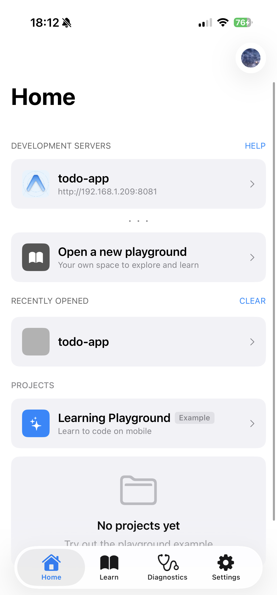
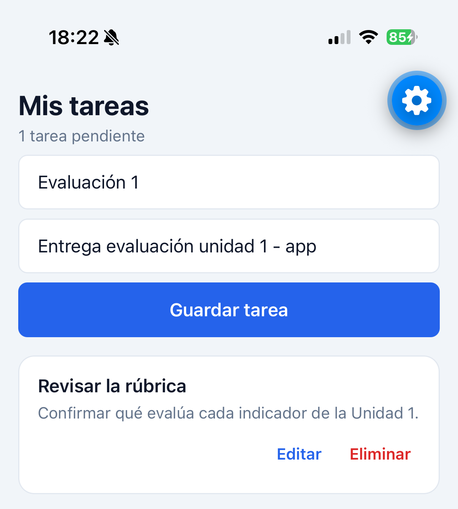
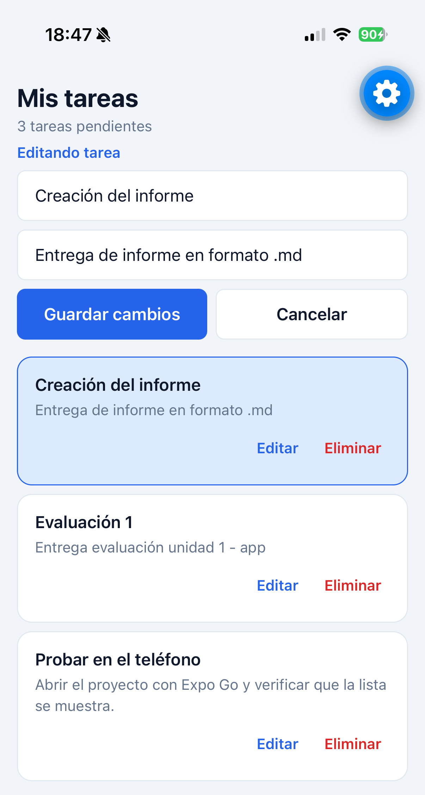
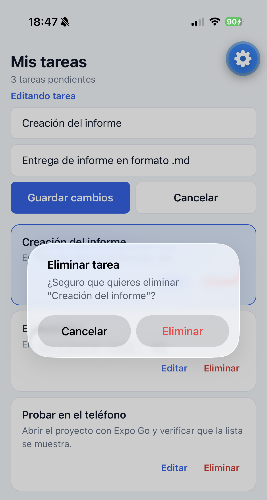
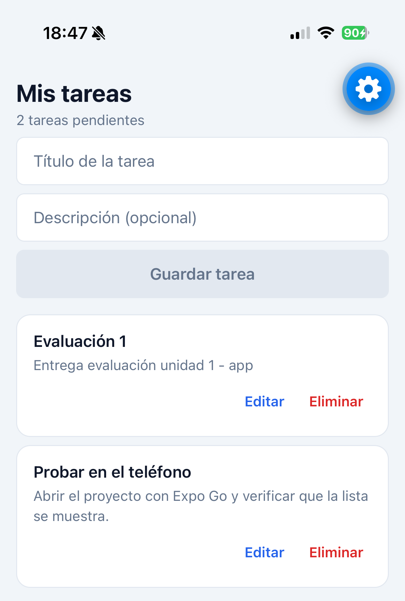

# EVU1 — Lista de tareas (To‑Do List) con React Native + Expo + TypeScript

| Campo | Valor |
|---|---|
| Asignatura | Desarrollo de Aplicaciones Móviles (IF206IINF) |
| Evaluación | Sumativa Unidad 1 · 10% de la nota final |
| Integrante | Cristopher López Montenegro |
| Docente | Boris Belmar |
| Fecha | 1 de noviembre de 2026 |
| Estado | Versión final, cerrada tras las pruebas en el dispositivo |

---

## 1. Introducción

Este informe documenta el desarrollo de una aplicación móvil de lista de tareas (*To-Do List*) construida con React Native, Expo y TypeScript, para la evaluación sumativa de la Unidad 1 de Desarrollo de Aplicaciones Móviles.

El documento se organiza en tres bloques. En el primero presento el proyecto: qué problema resuelve, qué objetivos perseguí y qué requisitos debía cumplir. En el segundo justifico las decisiones técnicas —en particular la elección del conjunto de tecnologías— y describo el entorno, la arquitectura y los componentes. En el tercero registro la implementación de cada funcionalidad, las pruebas que realicé y las evidencias obtenidas.

Un criterio recorre todo el documento: **cada decisión aparece junto con su costo**. Elegir una tecnología no es afirmar que sea la mejor en abstracto, sino explicar qué se gana, qué se sacrifica y por qué, en este caso, el intercambio se justifica.

## 2. Descripción del proyecto

La aplicación es una lista de tareas pendientes. Permite registrar tareas nuevas, verlas, editarlas y eliminarlas.

Cada tarea tiene dos datos: un **título**, obligatorio, y una **descripción**, opcional.

El alcance de esta unidad no incluye almacenamiento permanente: las tareas viven en la memoria de la aplicación mientras está abierta. La estructura del proyecto queda preparada para incorporarlo en las unidades siguientes, junto con la autenticación de usuarios y la comunicación con servicios externos.

## 3. Objetivos

**Objetivo general.** Desarrollar una aplicación móvil básica que permita registrar y visualizar una lista de tareas pendientes, aplicando componentes de interfaz de usuario y una estructura de proyecto ordenada.

**Objetivos específicos.**

1. Instalar y configurar el entorno de desarrollo necesario.
2. Crear y estructurar un proyecto con una separación clara de responsabilidades.
3. Implementar la interfaz: encabezado, formulario, lista y acciones por tarea.
4. Implementar las operaciones sobre las tareas: agregar, editar y eliminar.
5. Verificar el funcionamiento en un dispositivo móvil físico.
6. Documentar el proceso y justificar técnicamente las decisiones tomadas.

## 4. Análisis de los requisitos

Los requisitos del enunciado y la forma en que los resolví:

| Requisito | Cómo se resuelve |
|---|---|
| Registrar y visualizar una lista de tareas | `FormularioTarea` captura los datos y `ListaTareas` los muestra |
| Cada tarea con título y descripción | La interfaz `Tarea` en `src/types/tarea.ts` define ambos campos |
| Agregar tareas | `agregarTarea` en `useTareas`, invocada desde el formulario |
| Limpiar el formulario al agregar | El formulario es controlado y vacía su estado después de guardar |
| Editar tareas | El formulario se reutiliza en modo edición; `editarTarea` aplica el cambio |
| Eliminar tareas | Botón por tarea, con confirmación previa; `eliminarTarea` aplica el cambio |
| Interfaz con componentes de lista | `FlatList` con un `ItemTarea` por tarea |
| Documentar el proceso y entregar capturas | Este informe y la sección de evidencias |
| Proyecto accesible en un servidor local | `npx expo start` publica la aplicación en `http://localhost:8081` |
| Framework de frontend: Angular, React o Vue | Se utiliza **React**, uno de los tres admitidos, a través de React Native |

Tres diferencias reales respecto del enunciado, que dejo por escrito:

- **Tecnología.** El enunciado nombra Ionic. El docente otorgó libertad para elegir otra y sugirió React Native; la decisión y su justificación están en la sección 5.
- **Puerto.** El enunciado indica el 8100, que es el valor por defecto del servidor de desarrollo de Ionic. Expo publica en el **8081**, el de su propio empaquetador (Metro). El requisito de fondo —servir la aplicación en un servidor local para probarla— se cumple.
- **Componentes.** El enunciado nombra componentes de Ionic (`ion-header`, `ion-list`, `ion-item`, `ion-input`, `ion-button`). En React Native no existen, pero cada uno tiene un equivalente directo, detallado en la sección 9.

## 5. Justificación de las tecnologías seleccionadas

### 5.1 El marco en que tomé la decisión

El enunciado propone Ionic y menciona Angular, React o Vue como frameworks de frontend. En clases, el docente precisó el alcance de esa indicación: dejó **libertad para elegir la tecnología** (mencionó Ionic, React Native, Kotlin y Swift), **sugirió React Native** y expresó que personalmente no recomendaba tanto Ionic, por su percepción sobre el uso de ese framework en la industria. Puso **tres condiciones** —que la aplicación funcione, que pueda demostrarse con un video y capturas, y que el código corresponda a lo desarrollado— y sumó una cuarta: **justificar técnicamente la elección**.

De ahí surge el criterio de este apartado: **la recomendación del docente fue un factor de la decisión, pero no su justificación**. Elegir una tecnología porque alguien la recomendó no es justificar: es trasladar la decisión a otra persona. Por eso la trato como un criterio más, junto a los técnicos:

| Criterio | Peso |
|---|---|
| Un solo código para Android y iOS | Alto |
| Un lenguaje que ya estoy trabajando en la asignatura | Alto |
| Probar en un teléfono real sin compilar | Alto |
| Recomendación del docente | Medio |
| Ecosistema y documentación disponibles | Medio |
| Simplicidad para el alcance de la Unidad 1 | Medio |

Los tres primeros son razones técnicas y comprobables, y son los que sostienen la elección; la recomendación operó como orientación. De hecho, descarté la propuesta original del enunciado por razones técnicas, no por su opinión.

### 5.2 Por qué React Native

React Native construye la interfaz con **componentes nativos reales**: un `Text` termina siendo una vista de texto del sistema, no un elemento dentro de un navegador. Eso lo distingue del enfoque híbrido de Ionic, donde la interfaz web se ejecuta dentro de un WebView administrado por Capacitor. Para una aplicación que debe responder con fluidez a gestos y al teclado —como esta, donde el formulario convive con una lista—, evitar esa capa intermedia es una ventaja concreta y no una preferencia estética.

### 5.3 Por qué el lenguaje: JavaScript y TypeScript

React Native no impone un lenguaje propio: se programa en JavaScript, con TypeScript por encima. Es, a mi juicio, el punto más fuerte de la elección:

| Alternativa | Lenguaje | Qué implica |
|---|---|---|
| **React Native** (elegida) | JavaScript / TypeScript | Es el lenguaje del desarrollo web; sin sintaxis nueva, y lo aprendido se reutiliza fuera del framework |
| Ionic | JavaScript / TypeScript | Mismo lenguaje, pero la interfaz se ejecuta dentro de un WebView |
| Flutter | Dart | Lenguaje propio del framework, que prácticamente solo se usa en él |
| Kotlin (Android nativo) | Kotlin | Maduro, pero sirve únicamente para Android |
| Swift (iOS nativo) | Swift | Maduro, pero sirve únicamente para iOS |

Un lenguaje atado a una sola plataforma obliga a escribir el proyecto dos veces; uno atado a un solo framework obliga a empezar de cero si se cambia de herramienta. **JavaScript y TypeScript no tienen ese problema**: son transversales al desarrollo web y ya forman parte de mi formación, así que el trabajo de esta unidad no queda encerrado en este proyecto.

### 5.4 Por qué Expo

Expo es una capa sobre React Native que administra la parte nativa: la configuración de compilación, el servidor de desarrollo y el acceso a funcionalidades del dispositivo mediante módulos ya integrados. Sin ella, iniciar un proyecto exige instalar los entornos nativos de Android y de iOS.

Aporta dos cosas concretas: crear el proyecto con un solo comando y **probarlo en un teléfono físico sin generar una aplicación instalable**. Como límite, si se necesita un módulo nativo que Expo Go no incluye hay que compilar una versión de desarrollo propia; para el alcance de esta unidad no fue necesario.

### 5.5 Por qué TypeScript

TypeScript añade **tipos** a JavaScript: describe qué forma tienen los datos y avisa, antes de ejecutar, cuando algo no coincide. El modelo de una tarea está declarado explícitamente:

```ts
export interface Tarea {
  id: string;
  titulo: string;
  descripcion: string;
}
```

El beneficio apareció durante el desarrollo: cuando el formulario pasó a tener dos modos, el compilador detectó un cambio de tipado en una referencia sin necesidad de probar en el teléfono. Esa es la razón de preferirlo por sobre JavaScript puro.

### 5.6 Qué papel cumple Node.js

Node.js **no forma parte de la aplicación que se ejecuta en el teléfono**. Es el entorno que ejecuta las herramientas de desarrollo:

| Herramienta | Para qué la usé |
|---|---|
| npm | Descargar y registrar las dependencias del proyecto |
| Metro | Empaquetar el código y entregarlo al teléfono |
| TypeScript | Revisar los tipos del código |
| Expo CLI | Crear el proyecto y levantar el servidor de desarrollo |

En el teléfono corre la aplicación ya empaquetada, no Node.

### 5.7 Alternativas evaluadas y por qué no las elegí

| Alternativa | A favor | En contra |
|---|---|---|
| **Ionic** | La opción del enunciado; componentes ya hechos; reutiliza HTML y CSS | La interfaz se ejecuta dentro de un WebView, y el rendimiento depende de esa capa |
| **Flutter** | Motor de renderizado propio; apariencia idéntica en ambas plataformas | Obliga a aprender **Dart**, útil prácticamente solo en Flutter; aplicaciones más pesadas |
| **Kotlin** | Máximo rendimiento y acceso directo a las APIs | Solo cubre Android |
| **Swift** | Igual ventaja, en el ecosistema Apple | Solo cubre iOS, y exige macOS y Xcode |

El criterio de descarte fue el mismo en los cuatro casos: o no cubren ambas plataformas, o exigen un lenguaje atado a un único framework, o añaden una capa intermedia que no necesitaba.

### 5.8 Limitaciones de la elección

- **No es la del enunciado.** Ionic aparece nombrado en las instrucciones, así que usar React Native me obliga a justificar la elección y a explicar la equivalencia de componentes.
- **Dependencia del ecosistema de Expo.** Salir de Expo Go hacia una compilación propia es posible, pero implica trabajo adicional.
- **El puerto cambia** respecto de lo indicado en el enunciado (8081 en lugar de 8100).
- **Rendimiento por debajo del nativo puro.** Para una lista de tareas la diferencia no se percibe; en aplicaciones con gráficos intensivos, podría.

### 5.9 Síntesis

La elección de **React Native + Expo + TypeScript** se sostiene en tres razones técnicas verificables —un solo código para Android y iOS, un lenguaje transversal que ya estoy trabajando, y la posibilidad de probar en un teléfono real sin compilar— y en un criterio de orientación: la sugerencia del docente. Ninguna de las razones con que descarté las alternativas depende de esa recomendación.

## 6. Entorno de desarrollo y configuración

### 6.1 Herramientas del entorno

| Pieza | Versión | Para qué se usa |
|---|---|---|
| Node.js | 22.23.1 | Entorno de ejecución de JavaScript fuera del navegador; sobre él corren Metro, TypeScript, npm y Expo CLI |
| npm | 10.9.8 | Gestor de dependencias que acompaña a Node |
| Expo CLI | 58.1.18 | Lo usé a través de `npx expo`, sin instalación global: la versión queda fijada por el proyecto y no por el computador |
| Expo Go | aplicación móvil | Se instala en el teléfono y ejecuta el proyecto durante el desarrollo |

### 6.2 Creación del proyecto

Verifiqué el entorno con `node -v` y `npm -v`, y creé el proyecto con:

```
npx create-expo-app@latest todo-app --template blank-typescript
```

Elegí la plantilla *blank* de TypeScript por ser la mínima: crea el proyecto y nada más, sin navegación ni componentes que este trabajo no utiliza. Así, todo lo que aparece en el código está justificado.

### 6.3 El servidor de desarrollo

`npx expo start` inicia **Metro** (el empaquetador de React Native), publica la aplicación en `http://localhost:8081` y muestra la dirección `exp://<ip-local>:8081`, que es la que el teléfono necesita. Con el servidor en ejecución, cada cambio en un archivo se refleja en el teléfono en segundos y sin reinstalar nada.

### 6.4 Instalación y uso de Expo Go en el teléfono

1. **Instalar Expo Go.** Es una aplicación gratuita, disponible en la App Store y en Google Play. Se descarga una sola vez y sirve para cualquier proyecto de Expo.
2. **Conectar el teléfono a la misma red Wi-Fi que el computador.** El teléfono no descarga el proyecto desde internet: lo recibe del computador por la red local.
3. **Abrir el proyecto.** Con el servidor en ejecución, la terminal muestra un código QR y la dirección del proyecto; en Expo Go se escanea el QR o se escribe la dirección en la opción *Enter URL manually*.
4. **Esperar la primera carga.** Tarda entre 30 y 60 segundos, porque el proyecto se compila y se transfiere al teléfono.

En ningún momento generé un archivo instalable (APK ni IPA): la aplicación se ejecutó siempre a través de Expo Go.

### 6.5 Un obstáculo que quedó registrado: la sesión de Expo

**Expo Go en un iPhone físico exige que el teléfono y el computador estén autenticados con la misma cuenta de Expo** (documentación oficial: <https://docs.expo.dev/troubleshooting/expo-go-sign-in-required>). Mientras esa condición no se cumplió, el proyecto no abría y —esto es lo que dificultó el diagnóstico— **el servidor no reportaba ningún error en la terminal**: el mensaje aparecía únicamente en la pantalla del teléfono.

Cerrar la sesión en Expo Go no fue la solución: sin sesión en ninguna de las dos partes, la aplicación tampoco abre. Lo que funcionó fue `npx expo login` en el computador, con la misma cuenta del teléfono; la autenticación se hizo con el inicio de sesión del navegador, así que la contraseña nunca se escribió en la terminal. La exigencia aplica **solo a dispositivos iOS físicos**: Android, el emulador de Android, el simulador de iOS y las actualizaciones publicadas no están afectados.

## 7. Herramientas y versiones utilizadas

| Herramienta | Versión | Rol en el proyecto |
|---|---|---|
| Node.js | 22.23.1 | Entorno de ejecución de las herramientas |
| npm | 10.9.8 | Gestión de dependencias |
| Expo SDK | 58.0.22 | Plataforma sobre React Native |
| Expo CLI | 58.1.18 | Creación del proyecto, servidor de desarrollo y cuenta |
| React | 19.3.0 | Biblioteca de construcción de interfaces |
| React Native | 0.88.1 | Componentes nativos del dispositivo |
| TypeScript | 6.0.3 | Tipado estático, en modo estricto |
| Expo Go | app móvil | Ejecución del proyecto en el iPhone físico |

## 8. Arquitectura y estructura de carpetas

```
todo-app/
├── App.tsx                        Pantalla principal
├── index.ts                       Punto de entrada
├── app.json                       Configuración de la aplicación
├── tsconfig.json                  Configuración de TypeScript
├── assets/                        Íconos y recursos
└── src/
    ├── theme.ts                   Tokens de diseño (colores, espaciados, tipografía)
    ├── types/
    │   └── tarea.ts               Modelo de una tarea
    ├── data/
    │   └── tareasIniciales.ts     Datos de ejemplo
    ├── hooks/
    │   └── useTareas.ts           Estado de la lista
    └── components/
        ├── Encabezado.tsx         Barra superior
        ├── ItemTarea.tsx          Una tarea
        └── ListaTareas.tsx        La lista completa
```

La separación responde a una idea: **cada archivo tiene una sola responsabilidad**. El modelo define qué es una tarea; el origen de datos entrega la lista (hoy de ejemplo, en la Unidad 2 desde almacenamiento local); el hook concentra el estado y las operaciones; los componentes presentan; y `theme.ts` reúne colores, espaciados y tipografía.

Cuando el proyecto crezca —almacenamiento, autenticación, comunicación con APIs— solo cambian las capas de datos y estado; la presentación se mantiene.

## 9. Explicación de los principales componentes

Un componente es una función que devuelve interfaz. Cada uno cumple una sola responsabilidad:

| Componente | Archivo | Recibe (props) | Responsabilidad |
|---|---|---|---|
| `App` | `App.tsx` | — | Arma la pantalla y consulta el estado |
| `Encabezado` | `src/components/Encabezado.tsx` | `titulo`, `subtitulo` | Barra superior con el título y el contador |
| `FormularioTarea` | `src/components/FormularioTarea.tsx` | `tareaEnEdicion`, `onGuardar`, `onCancelar` | Captura los datos y avisa que hay una tarea nueva o editada |
| `ListaTareas` | `src/components/ListaTareas.tsx` | `tareas`, `idEnEdicion`, `onEditar`, `onEliminar` | Proyecta la lista completa |
| `ItemTarea` | `src/components/ItemTarea.tsx` | `tarea`, `enEdicion`, `onEditar`, `onEliminar` | Muestra una tarea y sus acciones |

Dos piezas no son componentes visuales: `useTareas` (`src/hooks/useTareas.ts`), que guarda la lista y expone las operaciones, y `theme` (`src/theme.ts`), que reúne los tokens de diseño.

**Props.** Son los datos que un componente recibe desde fuera; un componente no los inventa. `ItemTarea` recibe una `tarea`; `ListaTareas` recibe el arreglo completo y construye un `ItemTarea` por elemento.

**Estado.** Es un dato que puede cambiar mientras la aplicación se usa. El texto de los campos vive dentro de `FormularioTarea`; la lista, en `useTareas`. Cuando el estado cambia, la interfaz se vuelve a dibujar.

**Flujo de los datos.** El formulario no modifica la lista: avisa mediante `onGuardar`, una función que recibe por props. El hook actualiza el estado y la lista se redibuja. Esa dirección única evita que dos partes de la interfaz se contradigan.

**Equivalencia con Ionic.** `Encabezado` cumple el papel de `ion-header`; `ListaTareas`, el de `ion-list`; `ItemTarea`, el de `ion-item`; y cada `TextInput`, el de un `ion-input`.

## 10. Patrones de diseño que emplea el framework

### 10.1 Qué entiendo por patrón de diseño aquí

Un patrón de diseño es una solución conocida y reutilizable a un problema que aparece una y otra vez. No es código que se copia: es una forma de organizar el código ya probada en muchos proyectos. En React —la base de React Native— los patrones no se declaran en ningún archivo; se deducen de cómo el framework espera que se escriba el código.

### 10.2 Los patrones que emplea React en este proyecto

**Composición de componentes.** React favorece *componer* en lugar de *heredar*: la interfaz se arma anidando componentes, y cada uno aporta una parte. `App` compone tres piezas independientes:

```tsx
<Encabezado titulo="Mis tareas" subtitulo={subtitulo} />
<FormularioTarea tareaEnEdicion={tareaEnEdicion} onGuardar={guardarTarea} onCancelar={cancelarEdicion} />
<ListaTareas tareas={tareas} idEnEdicion={idEnEdicion} onEditar={setIdEnEdicion} onEliminar={solicitarEliminar} />
```

Ninguna sabe que las otras existen, así que puedo cambiar por completo el formulario sin tocar la lista.

**Presentación separada de la lógica.** `ItemTarea` y `ListaTareas` reciben datos ya listos y los muestran; no consultan ni modifican nada. Las decisiones —qué se edita, qué ocurre al guardar— viven en `App` y en `useTareas`. Los componentes visuales quedan reutilizables con cualquier origen de datos.

**Hook personalizado.** Cuando la lógica con estado crece, React propone extraerla a una función cuyo nombre empieza con `use`:

```ts
export function useTareas() {
  const [tareas, setTareas] = useState<Tarea[]>(tareasIniciales);
  const contador = useRef(tareasIniciales.length + 1);

  function agregarTarea(titulo: string, descripcion: string) { /* ... */ }
  function editarTarea(id: string, titulo: string, descripcion: string) { /* ... */ }
  function eliminarTarea(id: string) { /* ... */ }

  return { tareas, agregarTarea, editarTarea, eliminarTarea };
}
```

La pantalla no manipula la lista: pide las tareas y las operaciones. Si mañana los datos vinieran de un almacenamiento local, el cambio ocurriría en este único archivo.

**Flujo de datos unidireccional.** Los datos bajan por props y los cambios suben por funciones que también llegan por props. El formulario no modifica la lista: llama a `onGuardar(...)` y el estado cambia en un solo lugar. Así no puede haber dos partes de la interfaz en desacuerdo, porque una sola es dueña del dato.

**Estado elevado al ancestro común.** El estado se coloca en el componente común más cercano a quienes lo necesitan. `idEnEdicion` vive en `App` porque lo usan el formulario (para cargar los datos de la tarea) y la lista (para resaltar la tarjeta).

**Inmutabilidad del estado.** Las operaciones no modifican el arreglo existente: devuelven uno nuevo con `map` o `filter`. React compara referencias para decidir si debe redibujar, de modo que mutar el mismo arreglo dejaría la pantalla sin actualizar: la inmutabilidad es lo que hace predecible el redibujado.

**Renderizado declarativo.** El código describe *qué* debe verse para un estado dado, no *cómo* cambiarlo paso a paso: se cambia el estado y React calcula la diferencia.

### 10.3 Los patrones del apunte, vistos en esta aplicación

El apunte de la unidad describe tres patrones clásicos —MVC, Singleton y Factory—, que en React no aparecen con esos nombres pero sí con equivalentes reconocibles.

**MVC y la separación de responsabilidades.** React no implementa MVC de forma explícita —su unidad es el componente, no el controlador—, pero el mismo principio se cumple repartiendo responsabilidades entre archivos:

| Capa en MVC | Equivalente en este proyecto | Archivo |
|---|---|---|
| Modelo | La forma de los datos | `src/types/tarea.ts` |
| Vista | Los componentes que dibujan la interfaz | `src/components/` |
| Controlador | El estado y las operaciones sobre los datos | `src/hooks/useTareas.ts` |

Quien sí implementa MVC de manera explícita es **Angular**, el framework con el que Ionic se combina habitualmente; React resuelve lo mismo con composición y hooks.

**Singleton: una única instancia compartida.** El proyecto tiene un singleton real y deliberado: `theme`. Un módulo de JavaScript se evalúa una sola vez, así que todos los componentes que lo importan reciben **la misma instancia**; si cambiara un color en ese archivo, cambiaría en toda la aplicación.

En cambio, **la lista de tareas no es un singleton, y es una decisión consciente**: `useTareas` se ejecuta dentro de `App`, de modo que el estado pertenece a ese componente. Si la aplicación creciera a varias pantallas, se compartiría con `Context` —el mecanismo que React ofrece para una instancia compartida—. Lo dejo anotado porque es frecuente confundir "una función que se llama una vez" con "una única instancia compartida por toda la aplicación".

**Factory: crear objetos sin exponer su construcción.** `agregarTarea` actúa como una fábrica: quien la llama entrega un título y una descripción, y recibe una tarea ya formada, con su identificador asignado y su lugar en la lista.

```ts
function agregarTarea(titulo: string, descripcion: string) {
  const nueva: Tarea = { id: String(contador.current), titulo, descripcion };
  contador.current += 1;
  setTareas((previas) => [nueva, ...previas]);
}
```

React usa el mismo patrón en su nivel más básico: `createElement` es la fábrica de elementos, y JSX es la manera legible de invocarla.

### 10.4 Resumen

| Patrón | Dónde está en el proyecto | Qué aporta |
|---|---|---|
| Composición de componentes | `App` compone encabezado, formulario y lista | Cambiar una pieza sin tocar las demás |
| Presentación separada de la lógica | `ItemTarea` y `ListaTareas` frente a `App` | Componentes visuales reutilizables |
| Hook personalizado | `src/hooks/useTareas.ts` | La lógica de datos en un solo lugar |
| Flujo unidireccional | props hacia abajo; `onGuardar`, `onEditar`, `onEliminar` hacia arriba | Una sola fuente de verdad |
| Estado elevado | `idEnEdicion` en `App` | Sin información duplicada |
| Inmutabilidad del estado | `map`, `filter`, `...previas` | Redibujado predecible |
| Renderizado declarativo | Toda la interfaz | Menos código y menos errores |
| Singleton | `theme` | Consistencia visual garantizada |
| Factory | `agregarTarea` | El identificador no se filtra a quien llama |

## 11. Diseño de la interfaz de usuario

### 11.1 De dónde salen los valores

Ningún componente escribe un color, un tamaño o un espaciado a mano: todos los toman de `src/theme.ts`. Eso hace que los principios que siguen no sean una intención declarada, sino una propiedad verificable del código.

### 11.2 Jerarquía visual

La jerarquía indica al ojo qué leer primero, y aquí se construye con tres recursos: **tamaño** (título 24 pt, cuerpo 16 pt, secundario 14 pt), **peso** (título y botón en 700 y 600; el cuerpo en 400) y **color** (texto principal `#0F172A`; descripciones `#64748B`, deliberadamente más claro). Así se distinguen tres niveles sin necesidad de líneas ni separadores. El único elemento con fondo sólido azul es el botón *Guardar tarea*: es la acción principal y no compite con nada.

### 11.3 Balance

La pantalla se centra con un ancho máximo de 720 px, y el encabezado, el formulario y la lista comparten los mismos márgenes laterales, de modo que todo se apoya en un mismo eje vertical. Dentro de cada tarjeta, el texto va a la izquierda y las acciones a la derecha; y el formulario reparte sus dos botones con el mismo ancho (`flex: 1`), para que ninguno parezca más importante por accidente.

### 11.4 Contraste

El contraste cumple dos funciones: que lo importante se distinga y que el texto se pueda leer. El detalle más relevante es el botón **inactivo**: no solo cambia el fondo a gris claro, sino que **también cambia el color del texto**. Si solo cambiara el fondo, quedaría texto blanco sobre gris claro, ilegible. Además, la acción destructiva (*Eliminar*) se distingue en rojo, separada de *Editar*, que va en azul.

### 11.5 Ritmo

Todos los espaciados provienen de una escala de cinco valores —4, 8, 16, 24 y 32 px— aplicada con criterio constante: 8 px entre tarjetas, 16 px de margen lateral y de relleno interno, 24 px de respiro al final de la lista. Al repetirse, el ojo deja de calcular distancias y la pantalla se percibe ordenada.

### 11.6 Proporción

Las medidas guardan relación entre sí: los elementos táctiles tienen **48 px de alto mínimo**, el tamaño que recomiendan las guías de accesibilidad para un dedo; los radios de borde (8, 14 y 20 px) crecen con el tamaño del elemento; y el ancho máximo de 720 px mantiene las líneas en torno a 90 caracteres, el rango cómodo de lectura.

### 11.7 Navegación y menús: por qué la aplicación es de una sola pantalla

Este punto exige explicación, porque la rúbrica menciona los menús y los navegadores entre los componentes que espera encontrar, y aquí no existen. La razón no es un olvido:

- **El enunciado pide una sola página.** Su instrucción es textual: "una página principal que muestre una lista de tareas", más un formulario para agregar. La navegación no aparece en ninguna parte de lo solicitado, y agregarla sería incorporar un requisito que nadie pidió.
- **Con una pantalla no hay a dónde navegar.** Un navegador sirve para moverse entre vistas; con una sola, sería una capa técnica sin función. Lo mismo ocurre con un menú lateral: organiza el acceso a varias secciones, y con una sola sería un botón que abre un menú vacío.
- **El costo no sería neutro.** Incorporar React Navigation —el equivalente a `ion-nav` en React Native— significa sumar varias dependencias, cambiar el punto de entrada del proyecto y volver a probar todo en el dispositivo, a cambio de ninguna funcionalidad nueva.

La estructura sí está preparada para el cambio: `App.tsx` es hoy el único punto de composición, y los componentes son independientes entre sí, de modo que incorporar navegación consistiría en envolver el contenido en un navegador y mover cada bloque a su propia pantalla, sin reescribir ninguno. El propio enunciado anticipa cuándo hará falta: al proyectar la Unidad 2 con almacenamiento local, autenticación y APIs externas. La autenticación, en particular, introduce pantallas de acceso y de sesión, y ese es el momento en que la navegación deja de ser decorativa.

## 12. Usabilidad

Una interfaz es **intuitiva y fácil de usar** cuando el usuario no tiene que detenerse a pensar qué hacer. La usabilidad se juega en decisiones pequeñas; estas son las que tomé, agrupadas por el problema que resuelven.

### 12.1 Reducir el esfuerzo

El formulario está **siempre a la vista**, arriba de la lista: agregar una tarea no exige buscar un botón ni cambiar de pantalla. La tarea nueva **aparece al principio**, así que su efecto se ve sin desplazarse. La tecla *siguiente* del teclado **salta del título a la descripción**, y desde la descripción guarda: se puede crear una tarea sin tocar la pantalla. Y los **campos se limpian solos** al guardar, de modo que la siguiente tarea se escribe de inmediato.

### 12.2 Prevenir errores

El botón de guardar está **inactivo mientras no haya título**: es preferible impedir la acción que permitirla y luego mostrar un error. Los espacios sobrantes se recortan con `trim()`, así que no se pueden guardar tareas "vacías" escritas con espacios. El **borrado pide confirmación** y muestra el título de la tarea afectada, porque es la única acción que no se puede deshacer. Y al editar **siempre hay salida**: el botón *Cancelar* revierte sin dejar rastro.

### 12.3 Dar respuesta a cada acción

El encabezado muestra el **contador de tareas pendientes**, que se actualiza en el mismo instante en que cambia la lista. La tarjeta en edición **se resalta** con un borde azul y un fondo más claro, y el formulario avisa *Editando tarea*: nunca queda la duda de qué se está editando. Los botones **cambian al presionarse** (bajan su opacidad), así el toque se siente registrado.

### 12.4 Accesibilidad

Cada campo y cada botón llevan etiqueta para lectores de pantalla (`accessibilityLabel`), y los botones declaran su función (`accessibilityRole="button"`) y su estado (`accessibilityState`). Por ejemplo, el botón de borrar se anuncia como "Eliminar la tarea Revisar la rúbrica", y no como un "Eliminar" suelto, que sería ambiguo. Las áreas táctiles respetan el mínimo de 48 px, con un margen extra (`hitSlop`) en los botones pequeños de las tarjetas, y el contraste del texto es el descrito en el apartado 11.4.

### 12.5 Adaptarse al dispositivo

**El teclado no tapa el formulario**: la pantalla se ajusta mientras el teclado está abierto. **Los botones responden aunque el teclado esté abierto** —sin la configuración adecuada, el primer toque solo cierra el teclado y el usuario cree que el botón no funciona—. El contenido **se centra y no supera los 720 px**, así que en tablet o en pantalla grande las líneas siguen siendo legibles. Y se respeta la zona segura del dispositivo, de modo que el encabezado no queda bajo la barra de estado del teléfono.

### 12.6 Lo que no está verificado

Conviene ser preciso: **no realicé una prueba de usabilidad con usuarios**. Las afirmaciones anteriores se apoyan en los principios de diseño, en las convenciones del sistema operativo y en mi propia revisión durante las pruebas en el dispositivo; no en mediciones de tiempo, de errores ni de satisfacción. Para respaldarlas con datos habría que observar a varias personas usando la aplicación y registrar en qué momentos dudan.

## 13. Implementación de las funcionalidades

### 13.1 Agregar una tarea

1. Escribo en los campos de `FormularioTarea`. Cada carácter actualiza el estado del componente (`setTitulo` / `setDescripcion`): es un formulario **controlado**.
2. El botón permanece inactivo mientras el título esté vacío o contenga solo espacios.
3. Al pulsar *Guardar tarea*, el componente llama a `onGuardar(titulo, descripcion)`. El formulario no toca la lista: solo avisa.
4. `useTareas.agregarTarea` construye el objeto con el siguiente identificador y lo coloca al principio de la lista.
5. React redibuja: `ListaTareas` recibe el arreglo nuevo y muestra la tarea.
6. El formulario limpia sus campos, como pide el enunciado.

Decisiones deliberadas:

- **El identificador lo asigna un contador** guardado en una referencia, y no la hora (`Date.now()`): dos tareas creadas en el mismo milisegundo compartirían identificador, y es justamente lo que distingue una tarea para editarla o eliminarla.
- **La tarea nueva va primero**, para que quede a la vista sin desplazarse.
- **No existen tareas vacías:** el botón se desactiva sin título y los espacios sobrantes se recortan con `trim()`.

### 13.2 Editar una tarea

Reutilicé el mismo formulario en lugar de crear uno nuevo. La pantalla guarda el identificador de la tarea en edición (`idEnEdicion`); mientras exista, el formulario entra en modo edición: carga los campos con los datos de esa tarea —un `useEffect` sincroniza el estado del formulario—, la tarjeta se resalta, aparece el aviso *Editando tarea* y el botón pasa a *Guardar cambios*, con un *Cancelar* al lado. Al guardar, `editarTarea` reemplaza el título y la descripción **conservando el identificador y la posición** de la tarea.

Guardé el **identificador** y no la tarea completa: si la lista cambia, la tarea se vuelve a buscar por su `id` y nunca queda en pantalla una copia desactualizada.

### 13.3 Eliminar una tarea

El botón *Eliminar* abre una alerta que muestra el título de la tarea, porque el borrado no tiene deshacer. Confirmada la acción, `eliminarTarea` devuelve la lista sin esa tarea; si era la que se estaba editando, el formulario vuelve al modo agregar.

En las tres operaciones no modifico la lista existente: construyo una **lista nueva** (`map` para editar, `filter` para eliminar). React detecta el cambio por la referencia del arreglo; si mutara el mismo, la interfaz no se redibujaría.

## 14. Pruebas realizadas y resultados

Probé la aplicación **en ejecución**, en un iPhone físico, además de las comprobaciones automáticas del entorno. El procedimiento para instalar Expo Go y abrir el proyecto está en la sección 6.

| Prueba | Cómo se verificó | Resultado |
|---|---|---|
| Compilación de tipos | `npx tsc --noEmit` sobre todo el proyecto | Sin errores |
| El código servido es el del proyecto | Revisé el paquete que entrega el servidor de desarrollo y comprobé que contiene los textos de la aplicación | Confirmado |
| Visualización de la lista | Observé la pantalla en el dispositivo | Correcto: encabezado, contador y tarjetas |
| Agregar una tarea | Escribí título y descripción, guardé y observé la lista | La tarea aparece al inicio y los campos se limpian |
| Editar una tarea | Pulsé *Editar*, modifiqué los campos y guardé | El formulario se carga con los datos, la tarjeta se resalta y el cambio se aplica |
| Eliminar una tarea | Pulsé *Eliminar* y confirmé en la alerta | La tarea desaparece de la lista y el contador se actualiza |
| Eliminar la tarea que se está editando | Edité una tarea, pulsé *Eliminar* sobre esa misma tarea y confirmé | La tarea desaparece **y los campos del formulario quedan vacíos**, con el botón de vuelta en su estado inactivo |

### 14.1 Defecto encontrado y corregido

Las pruebas no solo confirmaron lo que funcionaba: también mostraron un comportamiento no previsto. Al **eliminar la tarea que se estaba editando**, el formulario volvía al modo agregar pero **conservaba el texto de la tarea eliminada** en los campos. El riesgo era concreto: si a continuación pulsaba *Guardar tarea*, creaba una copia de una tarea que acababa de eliminar.

La causa era que los campos se vaciaban únicamente al guardar o al cancelar. Cuando la edición terminaba por otra vía —el borrado de la tarea—, nadie los limpiaba. La corrección consistió en que el formulario reaccione también a la **salida** del modo edición, y no solo a la entrada.

El caso queda documentado porque es representativo: un mismo estado (`idEnEdicion`) puede cambiar por caminos distintos, y el componente debe responder a todos, no solo al que se tuvo en mente al escribirlo. La corrección se **verificó en el dispositivo**: al repetir la secuencia —editar una tarea, eliminarla y confirmar la alerta— los campos quedan vacíos y el botón vuelve a su estado inactivo, como muestra la captura del apartado 15.5.

## 15. Evidencias mediante capturas de pantalla

Las siguientes capturas fueron tomadas en un iPhone físico con la aplicación en ejecución mediante Expo Go.

### 15.1 El proyecto publicado por el servidor de desarrollo



Expo Go detecta el servidor de desarrollo y muestra el proyecto disponible en la red local.

### 15.2 El formulario y la lista de tareas



La pantalla principal: encabezado con el contador, los dos campos del formulario, el botón de guardado y la lista. Cada tarjeta ofrece las acciones *Editar* y *Eliminar*.

### 15.3 Modo edición



Al pulsar *Editar*, el formulario se carga con los datos de esa tarea y muestra el aviso *Editando tarea*; el botón pasa a *Guardar cambios* y aparece *Cancelar*. La tarjeta en edición se resalta con un borde azul.

### 15.4 Confirmación antes de eliminar



El borrado no tiene deshacer, así que la aplicación pide confirmación mostrando el título de la tarea afectada.

### 15.5 Resultado después de eliminar



Confirmada la acción, la tarea desaparece, el contador baja de 3 a 2 pendientes y el formulario vuelve a su estado inicial: los campos vacíos —con sus marcadores de posición— y el botón *Guardar tarea* desactivado, porque no hay título escrito. Esta captura corresponde al defecto descrito en el apartado 14.1, ya corregido y comprobado.

## 16. Uso de inteligencia artificial durante el desarrollo

Utilicé un asistente de inteligencia artificial conversacional: **modelo `deepseek-v4.1-flash`, herramienta `omp`**. Su participación fue la siguiente:

| Tarea | Cómo participó |
|---|---|
| Explicar los conceptos de la unidad | Componentes, props, estado y hooks, explicados sobre el código de este proyecto |
| Proponer la estructura | La separación del código en `types`, `data`, `hooks`, `components` y `theme` |
| Escribir el código | La implementación de los archivos que componen la aplicación |
| Documentar | La redacción y el orden de este informe |

La dirección del trabajo fue mía. La elección de tecnología, la organización del proyecto, el formulario y las decisiones sobre edición y eliminación fueron presentadas como alternativas y aprobadas **antes** de implementarse; ninguna funcionalidad se incorporó por iniciativa del asistente. De hecho, la opción de agregar un estado de "tarea completada" se descartó justamente porque el enunciado no la pedía.

Verificación del trabajo asistido:

- Cada etapa compiló con TypeScript (`npx tsc --noEmit`) sin errores. Cuando el tipado de una referencia cambió en React Native 0.88, el compilador lo detectó y el código se corrigió.
- Comprobé que el código entregado al teléfono fuera el del proyecto, revisando el paquete que sirve el entorno de desarrollo.
- Probé las funcionalidades en un **iPhone físico** mediante Expo Go.
- Las afirmaciones técnicas sobre el comportamiento de las herramientas se apoyan en la documentación oficial citada en las referencias, no en supuestos del asistente.

## 17. Conclusiones

La aplicación cumple los requisitos planteados: registra tareas con título y descripción, permite editarlas y eliminarlas, y las presenta en una lista. También cumple las condiciones señaladas por el docente: funciona en un dispositivo móvil, el código corresponde a lo presentado y la elección tecnológica está justificada.

Tres conclusiones técnicas:

1. **La estructura pesa más que el código.** Separar modelo, origen de datos, estado y presentación me permitió agregar la edición y el borrado sin rehacer los componentes: el formulario ganó un modo y las operaciones se sumaron al hook.
2. **El tipado evita errores a tiempo.** Declarar la forma de una tarea hizo que los errores aparecieran mientras escribía el código y no al probarlo en el teléfono.
3. **Nombrar los patrones y ordenar los valores no es un adorno.** Reconocer los patrones que el framework ya trae —composición, hook personalizado, flujo unidireccional, inmutabilidad— me permitió distinguir qué partes del código eran decisiones propias y cuáles la convención de React. Y concentrar los valores visuales en `theme.ts` convirtió los principios de diseño en propiedades verificables, en lugar de buenas intenciones escritas en un documento.

Limitaciones reconocidas:

- **No hay almacenamiento permanente:** las tareas se pierden al cerrar la aplicación, porque el alcance de esta unidad no lo contempla.
- **El puerto del servidor de desarrollo es 8081**, no el 8100 indicado en el enunciado, por la herramienta utilizada.
- **Usé React Native y no Ionic**, dentro de la libertad que otorgó el docente y con su sugerencia sobre la mesa, y con la justificación técnica de la sección 5.
- **No realicé una prueba de usabilidad con usuarios**, tal como se explicita en el apartado 12.6.

Proyección: la estructura queda preparada para las unidades siguientes. Incorporar almacenamiento local debería afectar solo a `src/data` y `src/hooks`; la presentación no necesitaría cambios.

## 18. Referencias bibliográficas y documentación oficial

- Instituto Profesional San Sebastián, Dirección de Innovación Académica (2024). *Apunte N.º 1: Iniciando nuestro proyecto*. Desarrollo de Aplicaciones Móviles (IF206IINF). Santiago.
- Expo. (s. f.). *Expo Documentation*. https://docs.expo.dev
- Expo. (s. f.). *"You need to be signed in to Expo Go and Expo CLI" error*. https://docs.expo.dev/troubleshooting/expo-go-sign-in-required
- Meta. (s. f.). *React Native Documentation*. https://reactnative.dev
- Meta. (s. f.). *React Documentation*. https://react.dev
- Microsoft. (s. f.). *TypeScript Documentation*. https://www.typescriptlang.org/docs
- OpenJS Foundation. (s. f.). *Node.js Documentation*. https://nodejs.org/docs
- Ionic. (s. f.). *Ionic Framework Documentation*. https://ionicframework.com/docs
- Capacitor. (s. f.). *Capacitor Documentation*. https://capacitorjs.com/docs
